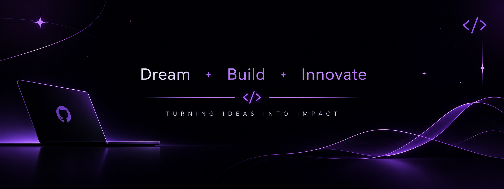

 <!-- ================= BANNER ================= -->

  

<h1 align="center">Sonam Gupta</h1>

<h3 align="center">Curious Mind | Developer | Constant Learner</h3>

  Exploring ideas, building things, solving problems, and discovering what's possible with technology.

  
  
  

---

## About Me

I'm a curious-minded person who enjoys exploring how things work and turning ideas into something real.

- I enjoy building applications and experimenting with new technologies.
- I like solving problems and challenging myself with new concepts.
- I believe the best way to learn is by building something.
- Always curious about what's new in the world of technology.
- Learning, experimenting, making mistakes, and improving every day.

---

## Tech Stack & Tools

  

  
  
  

---

## Featured Projects

<table>
<tr>
<td width="50%" valign="top">

<h3>💰 Money Manager</h3>

A personal finance management application designed to help users manage expenses and keep track of their transactions.

**Technologies:** React · Java · Spring Boot · PostgreSQL

<a href="https://github.com/sonammg-123/money-manager">View Source Code →</a>

<a href="https://moneymanager1995.netlify.app/">Live Application →</a>

</td>
<td width="50%" valign="top">

<h3>📊 Insights from Order Failure</h3>

A project exploring failed taxi and delivery orders, including patterns related to cancellations and driver assignments.

**Technologies:** Python · Pandas

<a href="https://github.com/sonammg-123/Insights-from-Order-Failure">View Project →</a>

</td>
</tr>

<tr>
<td width="50%" valign="top">

<h3>🍔 Swiggy Data Analysis</h3>

Explored a restaurant dataset and worked with real-world food delivery information.

**Technologies:** Python · Jupyter Notebook

<a href="https://github.com/sonammg-123/Swiggy-Data-Analysis">View Project →</a>

</td>
<td width="50%" valign="top">

<h3>📈 Stock Data Analysis</h3>

An interactive dashboard exploring stock market information, historical prices, and trends.

**Technologies:** Power BI

<a href="https://github.com/sonammg-123/stock-data-analysis">View Project →</a>

</td>
</tr>

<tr>
<td width="50%" valign="top">

<h3>👨‍💻 Employee Payroll System</h3>

A Java application focused on employee and payroll management, demonstrating object-oriented programming concepts.

**Technologies:** Java · OOP

<a href="https://github.com/sonammg-123/Employee-Payroll-System">View Project →</a>

</td>
<td width="50%" valign="top">

<h3>🏨 Hotel Reservation System</h3>

A project focused on hotel bookings and reservation management.

**Technologies:** Java

<a href="https://github.com/sonammg-123/Hotel-Reservation-System">View Project →</a>

</td>
</tr>
</table>

---

## 🎮 Live Projects

<h3>JavaScript Game</h3>

An interactive browser-based game built using HTML, CSS, and JavaScript.

  

  <b>HTML · CSS · JavaScript · Netlify</b>

---

## 💻 Coding Practice

I enjoy challenging myself with coding problems and learning through consistent practice.

  
  

---

## Other Projects

- [Car Rental System](https://github.com/sonammg-123/Car-Rental-System) — Rental management project.
- [Dice Roller](https://github.com/sonammg-123/Dice-Roller) — Interactive JavaScript project.
- [Credit Card Transaction Analysis](https://github.com/sonammg-123/Credit-card-taransaction-analysis) — A transaction-focused project.
- [Data Cleaning](https://github.com/sonammg-123/Data-cleaning) — A project exploring data preparation.
- [Employee Analyzing Trends](https://github.com/sonammg-123/Employee-Analyzing-Trends) — An employee-related project.

---

## Currently Exploring

- Backend development and application architecture
- Java and object-oriented programming
- Building interactive web applications
- New technologies and creative coding
- Problem-solving and software development

---

## Let's Connect

  <a href="https://github.com/sonammg-123">GitHub</a> ·
  <a href="https://linkedin.com/in/sonam-gupta-a9102b2b8">LinkedIn</a> ·
  <a href="mailto:sonamgupta052004@gmail.com">Email</a>

  <i>Stay curious. Keep building. Never stop exploring.</i>

  Thanks for stopping by! 💜

